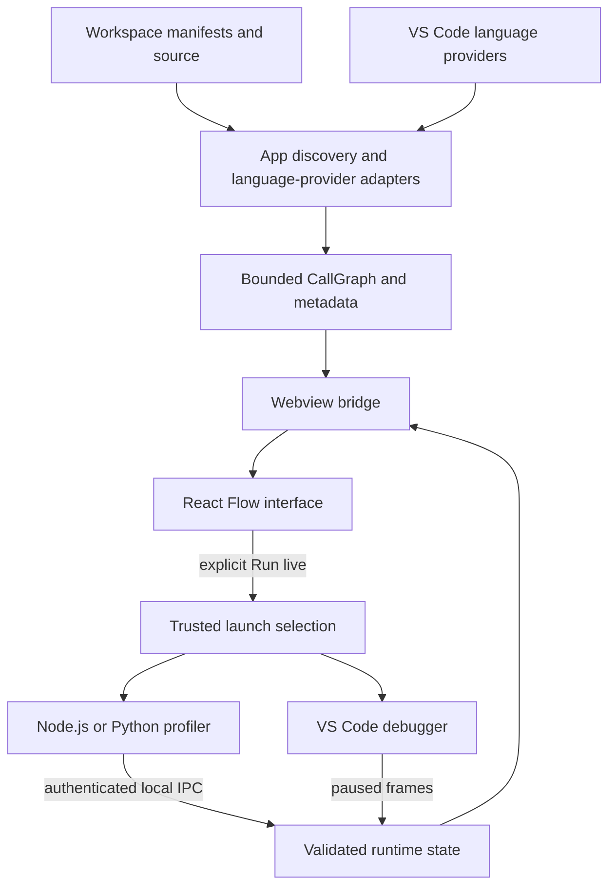

# Architecture

Diagram type: flowchart. Last verified: 2026-11-01.

## Purpose and boundaries

The extension discovers application candidates and source symbols, builds a bounded static graph, and sends presentation data to a React Flow webview. Users may separately request runtime observation. Discovery never starts an application.

src/extension.js composes the app explorer, graph providers, map, and live service. src/apps-view.js and src/workspace-apps.js own repository discovery; app-markers.js and app-entries.js isolate manifest classification and entry conventions from ownership assignment. src/app-scan.js seeds source functions; src/react-links.js adds resolved JSX relationships. src/graph.js owns graph identity and expansion. enrich-graph.js orchestrates cached adapters for classes, signatures, documentation, diagnostics, and conservative local complexity.

src/map.js owns panel lifecycle and validated message dispatch. src/live.js chooses trusted launches via launch-targets.js and launch-profile.js, observes debugger sessions, and projects runtime state onto known source locations. webview/ renders state and sends only commands/known IDs; it does not resolve source paths or execute workspace code.

runtime/preload.cjs and runtime/python/run.py run only in explicitly started targets. Telemetry crosses a random-token-protected local pipe or Unix socket and is bounded before entering host state. The webview uses local bundled assets, a script nonce, no remote script access, and inline styles only because React Flow positions nodes dynamically.

## Data and trust boundaries

There is no application database or external telemetry backend. Graphs, diagnostics, counts, and ordinary logs live in memory. Temporary fatal-error records are local; generated bundles and test reports are ignored. Files/manifests, language-provider responses, runtime messages, logs, and documentation are untrusted inputs. JSX text rendering escapes messages; source navigation resolves host-owned IDs. Workspace trust gates execution.

## Limitations and decisions

Provider-backed analysis avoids adding language parsers but inherits provider gaps. Manifest detection is heuristic; monorepo package boundaries are not proof of deployment boundaries. App maps exclude calls outside the selected app. Browser execution is debugger-only. Big-O badges describe local loop heuristics, not total algorithmic cost. No release or deployment architecture exists yet.

The initial 2026-10-31 baseline contained only .gitattributes; this document replaces that obsolete baseline with the implemented prototype. Diagram relationships were checked against source; local Mermaid rendering remains to be verified.

## Canvas hover presentation (2026-11-04)

MapCanvas owns transient pointer hover state. The pure hoverGraph projection decorates visible nodes and edges without mutating topology, positions, diagnostic data, or live state. Mode changes clear hover by remounting the canvas. CallEdge supplies a wider invisible pointer target and endpoint labels at the Bezier midpoint, including recursive loops. Hover styles are isolated in hover.css; no host messages or execution side effects are introduced.

## File and folder projection (2026-11-08)

The Files mode reuses observed graph data. fileGraph aggregates known functions and health by normalized source file and merges directed edges by file pair and relationship kind. folderLayout wraps file nodes in immediate-directory parent areas, emitting parents first and constraining child dragging. map-model namespaces parent and edge IDs consistently. Minimap navigation resolves absolute child positions. This is a presentation projection; host analysis and execution boundaries are unchanged. Files without discovered functions and import-only relationships are excluded explicitly.

## Architecture visualization estimate (2026-11-08)

Architecture mode estimates responsibility roles from scanned file paths and known framework metadata, grouping functions into UI, controllers/API, services, domain/models, data/integrations, shared utilities, tests, or Unclassified. architectureRoles owns matching conventions; architectureGraph owns evidence and pattern suggestions; architectureLayout positions role areas and keeps original edge directions. aggregateGraph is shared with fileGraph to retain common health and directed edge behavior. This refactoring changes presentation aggregation only, with unchanged function/class graph projections and host authority. Layered suggestions require two observed dependency stages; MVC is a naming estimate, and React/Next frontend suggestions combine metadata with UI conventions. Unknown designs are explicit. The UI does not infer microservices, databases, remote calls, or design-rule compliance.

## Source authoring boundary (2026-11-08)

The webview now sends explicit create/save/rename requests with bounded source text, revision tokens, and host-owned target IDs. It still cannot choose arbitrary filesystem paths or execute code. src/editing.js gates trust/view/debugger/concurrency; edit-targets owns the bounded hierarchy; edit-operations owns loaded snapshot authority. edit-symbol applies revision-checked declaration edits and installed-provider refactors. create-entity and entity-source implement no-overwrite file/folder creation and documented JS/TS/Python declarations. edit-safety enforces local workspace/realpath boundaries and portable names. AuthoringError distinguishes actionable validation from sanitized provider/filesystem failures.

src/map.js composes lifecycle, map-messages validates message navigation, map-state serializes snapshots, and map-sources debounces changed source across panels. refresh-map rebuilds provider symbols/calls and metadata caches over known workspace roots plus explicit new source files, preserving the selected root when it can be matched. File/folder resource metadata keeps empty entities visible. Unrecognized call/provider results remain explicit, and a successful source edit with a failed rescan is reported as applied with a stale-map warning.

Text edits use WorkspaceEdit followed by TextDocument.save for the deduplicated affected URI set. apply-and-save handles this shared path for edits, refactors and code creation; normal text undo remains available. Partial save failures return applied-but-unsaved warnings and still permit graph refresh. Folder creation uses workspace.fs.createDirectory. Renames depend on provider coverage; arbitrary source edits are not semantic refactors, and signature/body edits do not synthesize call arguments. Architecture is read-only. No additional dependency, source execution, or remote service is introduced.

Authoring also retains actual standalone/empty class declarations from scanned files through class-declarations and the class resolver, so removing the last method does not remove a class node. Published standalone class metadata is bounded by the graph limit, with omissions reported. Class diagnostics use source URI ownership as well as ranges, preventing unrelated files with matching line numbers from sharing health flags.

Creation presentation now separates HierarchyBrowser/hierarchy-model, CreationProperties, and the code body in CreateEntityForm. NodeEditButton opens the existing authoring workflow directly from editable cards. The create payload optionally includes bounded body text; the host inserts file contents atomically with file creation or wraps a declaration body in its validated name/language scaffold. No new provider authority or execution path is added.

Syntax coloring (2026-11-08): CodeEditor shares a native controlled textarea with an aria-hidden escaped React token mirror. syntax-tokens performs bounded-input lexical coloring for JS/TS/Python/JSON without executing code or changing payloads. Document language is included in authoring snapshots; creation infers language only from the selected/new file extension. Unknown grammars remain plain. This is a presentation aid, not syntax validation or semantic provider analysis; template/f-string interpolation and embedded JSX grammars are not parsed separately. No production dependency was added.

Modal/canvas identity fix (2026-11-08): AuthoringDialog and MapCanvas are sibling components and require distinct React key namespaces. Sharing the mode string left stale modal DOM even after hook state closed. authoring-${mode} and canvas-${mode} preserve per-mode resets without sibling-key collisions. A loopback/isolated-browser smoke test exercises the production bundle with real pointer and keyboard dismissal.

## Function-entry execution control (2026-11-08)

src/step-run.js holds debugger stops until Next sends continue to the retained session/thread. src/step-breakpoints.js installs source breakpoints before launch using executable body positions from function-entry.js and entry-tokens.js. Python docstrings/signatures and common JavaScript/TypeScript bodies are handled without executing source. Unresolved bodies are explicitly listed; no executable positions reject launch. Only owned breakpoints are removed on finish, failed launch or disposal; unconditional user breakpoints may be reused, and conditional/user logpoints remain untouched.

src/step-focus.js temporarily suppresses editor focus through the workspace debug.focusEditorOnBreak override, then restores it unless changed by the user. The launching panel receives a private reveal callback at pauses. Launch options suppress debugger view/toolbar and console opening. The live service adopts a marked session from early tracker events as well as onDidStartDebugSession, so an initial breakpoint can enable Next before the session-start event. Failures identify their launch/setup stage. Runtime profiling injection is absent in Step run. No dependencies or source edits are required.

Current/stack/visited state projects through existing function/class/file/architecture views. Completed runs retain visited IDs and disable Next. Source-map/native/provider gaps remain explicit limits. Real VS Code Python and JavaScript launches, repeated same-line calls, recursion, focus override and owned-breakpoint cleanup passed isolated API acceptance checks; browser/framework source-map acceptance remains pending.

Provider-range correction (2026-11-08): Pylance call-hierarchy items can describe only the function identifier. step-source-items.js resolves matching full document-symbol ranges, caching one provider request per source URI. Breakpoint setup and the private stepItems overlay use these resolved items; the original graph/provider items remain unchanged for subsequent call discovery. live-match uses the overlay for paused-stack matching without serializing provider objects to the webview. declaration-offset.js also handles broad signature/body selections. StepSetupError exposes deliberately composed, function-specific setup failures without internal provider errors.

Step focus correction (2026-11-08): owned Step run configurations carry visualizeStep. The debugger tracker sets DAP preserveFocusHint synchronously on their stopped events before forwarding to the workbench, including marked parent-session descendants. This prevents automatic stack-frame/source navigation; focusEditorOnBreak alone only preserves keyboard focus while source tabs may still open. Ordinary debugger sessions/events are unchanged. The initiating map reveal remains in place.

Stable execution layout (2026-11-08): StepControls reserves a fixed-height bottom area even when idle, with disabled Next/Stop. Runtime content scrolls within that area instead of resizing the canvas. MapToolbar reserves a fixed-width, single-line status slot with full text in its tooltip. Runtime snapshots retain existing node positions and viewport; no additional auto-layout or fitting is triggered.

Stable function identity (2026-11-08): layout projects React Flow IDs from encoded host function IDs rather than array indexes. Source/discovery reordering therefore retains each function/class/file node identity and the position already held by useMapNodes. Metadata-only text-document notifications with no contentChanges no longer trigger source rescans.

Canvas scope after authoring (2026-11-08): canvas-scope.js separates hierarchy targets from graph membership. Existing manifest discovery resolves current ownership and nested-app exclusions. Catalog refresh retains all valid creation destinations but filters serialized canvas resources. Refresh seeds entire-app owned files, a selected file, or only the matched starting function for a trace, then expands provider calls. Changed/created URI hints no longer become extra graph roots. Traces show only owners of participating methods; app/file scopes retain scoped empty classes. Source graph rebuilding retains limits, explicit provider warnings and rename-root matching.

## Flow workspace visual system (2026-11-08)

Presentation now uses shared CSS tokens in theme.css and focused workspace, node, inspector and canvas styles imported through style.css. Icon.jsx supplies decorative code-native SVGs with names provided by their controls; NodeHeading unifies node category/entry/edit anatomy. MapHeader retains modes/context, MapToolbar groups execution/discovery/authoring, and MapOverview owns canvas-edge zoom percentage, fit, arrange, minimap and a navigation-settings popover within React Flow context. Existing graph projection, source authority and execution adapters are unchanged.

Authoring uses responsive right-side drawers so the graph remains visible on wide windows. Header Create/Save actions are associated with stateful forms through native form IDs and React portals, preserving pinned controls. Hierarchy filtering retains actual ancestor/target IDs and folder descendants; it never changes the host catalog or grants new locations. Enter in search does not submit creation. Fixed execution chrome and non-layout-shifting authoring status preserve canvas geometry during updates. Stable function IDs, scope rules and graph positions remain intact. Initial layout uses downward subtree lanes; explicit Auto arrange incorporates measured card sizes without invoking layout on runtime updates.

Dark/light/high-contrast theme classes, keyboard focus indicators, text execution labels and reduced-motion rules provide a consistent baseline. Browser screenshots/checks cover desktop, 800px and 390px widths; high-contrast/touch desktop acceptance remains a manual item. Manual edge wiring, duplication/deletion, sharing and Playground are not introduced because edges remain source-detected relationships.

## Downward subtree layout (2026-11-08)

branch-positions.js builds a deterministic breadth-first spanning forest, reserving each target once. Source call-site lines and stable IDs order branches; independent roots precede cycle-only fallback roots. Bottom-up subtree widths allocate disjoint horizontal lanes, with parents centered above their descendant envelopes. Row heights use measured cards for Auto arrange and conservative defaults for first placement. Shared/cyclic calls remain original edges rather than extra nodes. Folder-area and architecture-role positioning remain separate.

layout-state.js distinguishes actual node/connection/root changes from metadata or array reordering. useMapNodes reapplies branch positions on topology changes and explicit Auto arrange; live/diagnostic updates preserve user positions, selection and measured dimensions. return-routes.js computes feedback/peer paths outside current visible bounds, including folder-relative positions, while CallEdge retains ordinary downward curves and recursive loops. This prevents feedback links from passing through intervening cards; shared links can still cross other connections in a general call graph. No graph relationships are inferred or removed.

App/file root selection correction (2026-11-08): map-root.js prefers a top-level main function, prioritizing declared entry/selected files, then another top-level function before falling back to a method. Explorer opening uses this instead of the provider insertion order. Explicit cursor/picker traces bypass this heuristic. This corrects Python files where class methods precede main in the provider results; main remains at the top and downstream calculate appears below tick.

File/app maps open with loading progress while language support initializes. Symbol requests retry for up to 30 seconds per file; users can cancel or retry without accepting late cancelled results. Confirmed 2026-11-08.

App-wide scans isolate per-file failures and retain usable results with file-specific notices. Valid empty symbol arrays are accepted after a one-second stabilization window for nonempty files; missing provider responses still have a 30-second timeout. All-file failures keep the retry screen. Verified 2026-11-09.
