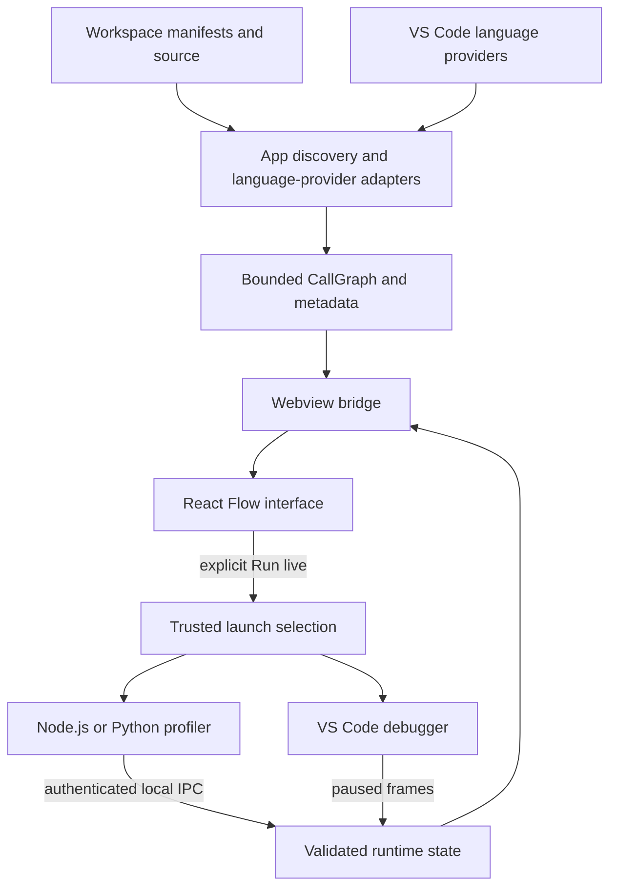

# Architecture

Diagram type: flowchart. Last verified: 2026-11-01.

## Purpose and boundaries

The extension discovers application candidates and source symbols, builds a bounded static graph, and sends presentation data to a React Flow webview. Users may separately request runtime observation. Discovery never starts an application.

src/extension.js composes the app explorer, graph providers, map, and live service. src/apps-view.js and src/workspace-apps.js own repository discovery; app-markers.js and app-entries.js isolate manifest classification and entry conventions from ownership assignment. src/app-scan.js seeds source functions; src/react-links.js adds resolved JSX relationships. src/graph.js owns graph identity and expansion. enrich-graph.js orchestrates cached adapters for classes, signatures, documentation, diagnostics, and conservative local complexity.

src/map.js owns panel lifecycle and validated message dispatch. src/live.js chooses trusted launches via launch-targets.js and launch-profile.js, observes debugger sessions, and projects runtime state onto known source locations. webview/ renders state and sends only commands/known IDs; it does not resolve source paths or execute workspace code.

runtime/preload.cjs and runtime/python/run.py run only in explicitly started targets. Telemetry crosses a random-token-protected local pipe or Unix socket and is bounded before entering host state. The webview uses local bundled assets, a script nonce, no remote script access, and inline styles only because React Flow positions nodes dynamically.

## Data and trust boundaries

There is no application database or external telemetry backend. Graphs, diagnostics, counts, and ordinary logs live in memory. Temporary fatal-error records are local; generated bundles and test reports are ignored. Files/manifests, language-provider responses, runtime messages, logs, and documentation are untrusted inputs. JSX text rendering escapes messages; source navigation resolves host-owned IDs. Workspace trust gates execution.

## Limitations and decisions

Provider-backed analysis avoids adding language parsers but inherits provider gaps. Manifest detection is heuristic; monorepo package boundaries are not proof of deployment boundaries. App maps exclude calls outside the selected app. Browser execution is debugger-only. Big-O badges describe local loop heuristics, not total algorithmic cost. No release or deployment architecture exists yet.

The initial 2026-10-31 baseline contained only .gitattributes; this document replaces that obsolete baseline with the implemented prototype. Diagram relationships were checked against source; local Mermaid rendering remains to be verified.
