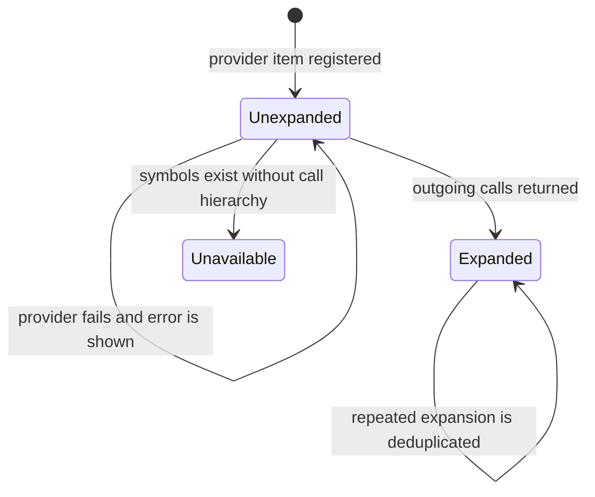
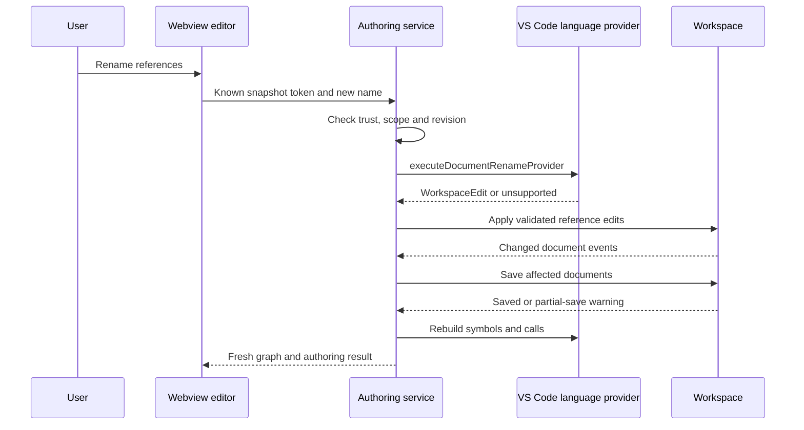

# Function Discovery Lifecycle

Diagram type: stateDiagram-v2. Last verified: 2026-11-01.

## Purpose and scope

Describe graph-node discovery without documenting every helper. These are conceptual states derived from loaded and callSupport, not a separate runtime enum.

CallGraph.add registers stable source identities; expand adds edges and marks a successful node loaded. A provider error preserves retryability. App scanning can retain a symbol-only node with an explicit unsupported-call message. Newly discovered callees each begin their own lifecycle; the expanded caller is not reset.

Relevant implementation: src/graph.js, src/app-scan.js, webview/useGraph.jsx. Runtime metrics and diagnostics decorate nodes independently of this lifecycle. No persistence or database entities exist. Mermaid rendering remains unverified locally.

## Source refactor interaction

Diagram type: sequenceDiagram. Last verified: 2026-11-08.
Purpose: show the host authority and source/map update sequence for a semantic rename.

Unsupported rename or stale revisions return explicit errors before application. Source writes followed by failed refresh return an applied result with a warning. Other map panels observe document changes. Relevant modules: src/edit-symbol.js, editing.js, refresh-map.js, map-sources.js. Provider coverage, desktop interaction and rendered Mermaid remain manual verification boundaries.
