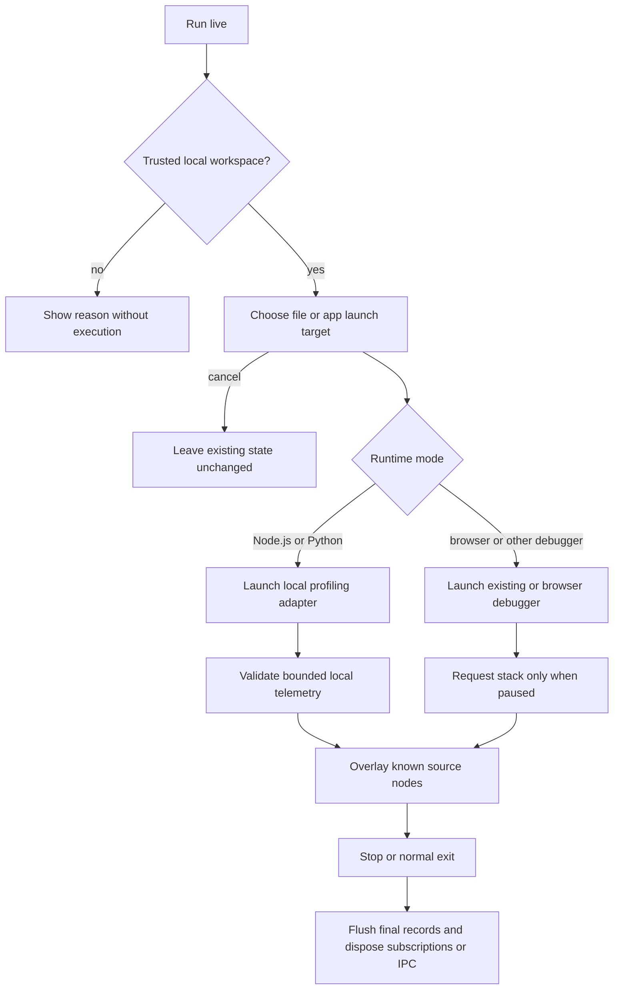

# Execution Flows

Diagram type: flowchart. Last verified: 2026-11-01.

## Application and file maps

Trigger: app/file selection in the Activity Bar explorer. Preconditions: an open workspace, readable source, and suitable language providers.

1. Discover bounded manifest/source candidates and assign files to their nearest app root.
2. Choose an app or file. Read symbols and prepare call-hierarchy items; symbol-only functions remain visible with missing-call support labeled.
3. Stop on cancellation. Otherwise add resolved JSX render links for React/Next.js and open a named map panel.
4. Enrich source metadata and diagnostics, then expand discovered calls sequentially within app boundaries.
5. Render nodes once, group classes on request, and navigate source only through known host IDs.

Unreadable files, missing symbols, unsupported calls, and limits produce scan notices. Cancellation prevents opening a new app map. Cursor tracing follows the same graph/panel flow with a single selected root. No source files are changed.

## Explicit live execution

The host validates local-file inputs and trust before launch. Existing launch environment options are preserved. Python uses a runner with original target arguments; Node.js uses a bootstrap in NODE_OPTIONS. No framework dependency is installed automatically. Python server targets use existing uvicorn, Flask, or Django environments. Browser sessions can attach as children of a running dev-server session.

Launch rejection, missing runtimes, disconnected IPC, provider failures, and unmapped source locations remain distinct limitations. One live root is managed at a time; unrelated debug sessions are ignored while it is active. No retry loop or network telemetry service is introduced. Logs can contain application data and must remain local.

Relevant implementation: src/apps-view.js, app-scan.js, map.js, live.js, launch-targets.js, launch-profile.js, debug-live.js, runtime-pipe.js, runtime-data.js, live-match.js, and runtime/. The diagram omits debugger-specific internals and worker completeness; those remain provider/runtime dependent. Mermaid rendering remains unverified locally.
