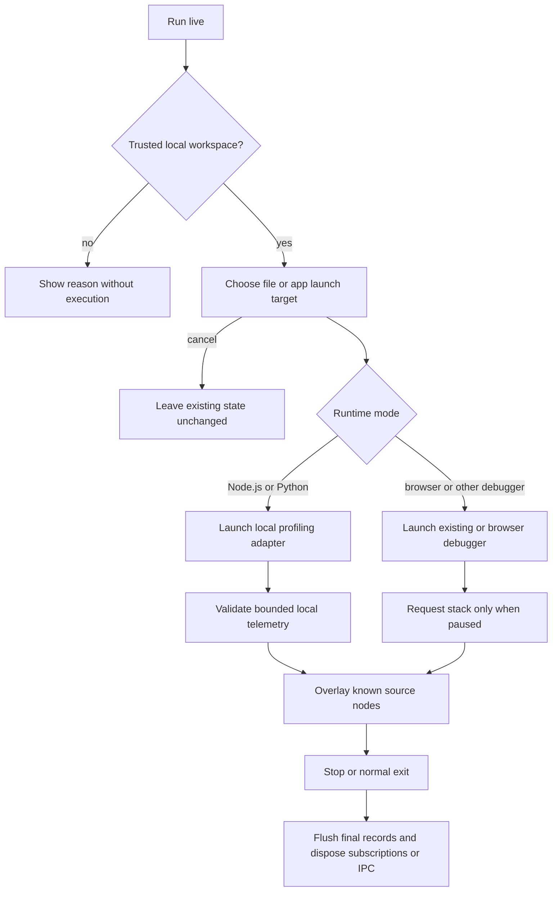
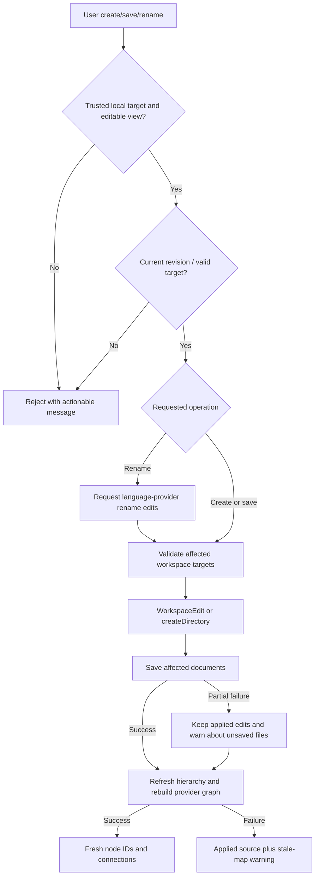
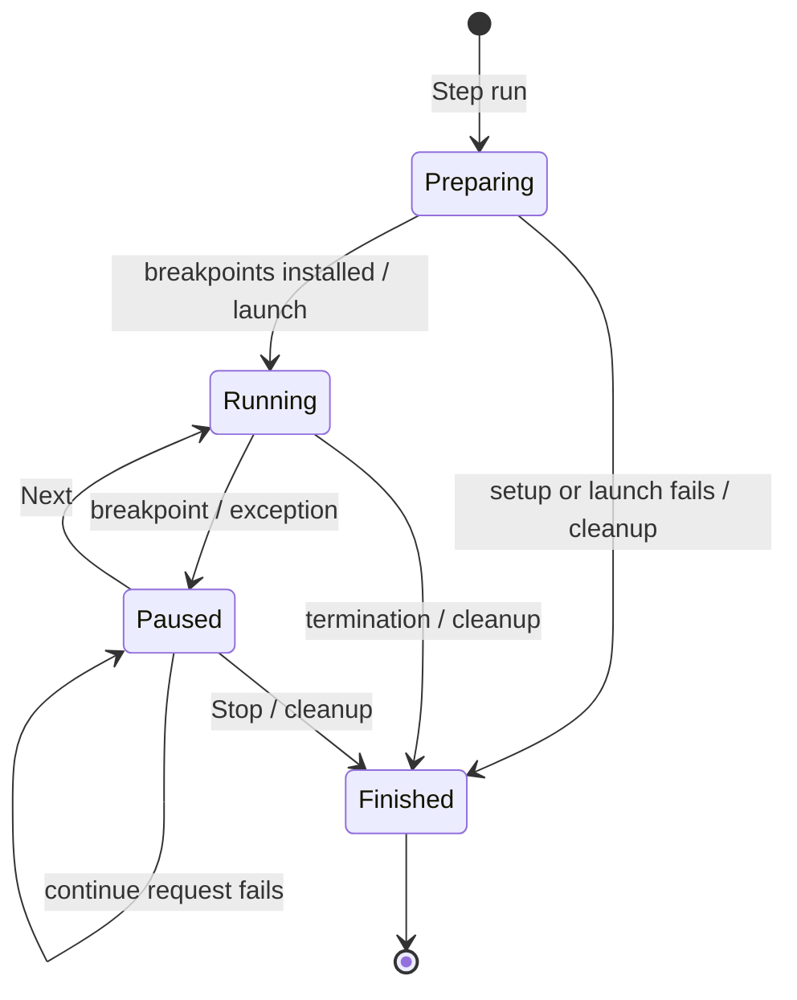

# Execution Flows

Diagram type: flowchart. Last verified: 2026-11-01.

## Application and file maps

Trigger: app/file selection in the Activity Bar explorer. Preconditions: an open workspace, readable source, and suitable language providers.

1. Discover bounded manifest/source candidates and assign files to their nearest app root.
2. Choose an app or file. Read symbols and prepare call-hierarchy items; symbol-only functions remain visible with missing-call support labeled.
3. Stop on cancellation. Otherwise add resolved JSX render links for React/Next.js and open a named map panel.
4. Enrich source metadata and diagnostics, then expand discovered calls sequentially within app boundaries.
5. Render nodes once, group classes on request, and navigate source only through known host IDs.

Unreadable files, missing symbols, unsupported calls, and limits produce scan notices. Cancellation prevents opening a new app map. Cursor tracing follows the same graph/panel flow with a single selected root. No source files are changed.

## Explicit live execution

The host validates local-file inputs and trust before launch. Existing launch environment options are preserved. Python uses a runner with original target arguments; Node.js uses a bootstrap in NODE_OPTIONS. No framework dependency is installed automatically. Python server targets use existing uvicorn, Flask, or Django environments. Browser sessions can attach as children of a running dev-server session.

Launch rejection, missing runtimes, disconnected IPC, provider failures, and unmapped source locations remain distinct limitations. One live root is managed at a time; unrelated debug sessions are ignored while it is active. No retry loop or network telemetry service is introduced. Logs can contain application data and must remain local.

Relevant implementation: src/apps-view.js, app-scan.js, map.js, live.js, launch-targets.js, launch-profile.js, debug-live.js, runtime-pipe.js, runtime-data.js, live-match.js, and runtime/. The diagram omits debugger-specific internals and worker completeness; those remain provider/runtime dependent. Mermaid rendering remains unverified locally.

## Selecting Files mode (2026-11-08)

Trigger: select Files in the visualizer mode control after scanning a graph. The webview attaches current health/live data, groups known functions by normalized file path, and merges calls/renders by file pair and kind. It lays out containing-folder parents before file children, then renders file-level links. Hover decorates existing links; clicking a file opens aggregate details and source actions retain original function IDs. Switching modes clears hover. Empty results remain empty; missing endpoints are excluded, and notices explain scan limitations. No additional source execution, host request, or external call is performed. Relevant modules: webview/fileGraph.js, folderLayout.js, map-model.js, MapCanvas.jsx, NodeDetails.jsx.

## Selecting Architecture mode (2026-11-08)

Trigger: select Architecture after scanning known functions. Attach current live/diagnostic state, classify file responsibilities using path conventions and existing framework metadata, group functions/edges through aggregateGraph, and produce the pattern/evidence report. Lay out responsibility rows and display detected arrows. Clicking an area opens its exact classification evidence and known source actions. Missing evidence yields Architecture undetermined; files with no recognized convention stay Unclassified. No code is executed and no external systems or relationships are invented. Relevant implementation: webview/architectureRoles.js, architectureGraph.js, architectureLayout.js, ArchitectureNode.jsx, aggregateGraph.js.

## Visual source authoring

Diagram type: flowchart. Last verified: 2026-11-08.
Purpose: apply explicit visual edits to real local source and refresh maps without guessing identity or overwriting newer text.
Trigger: New entity, Edit node, per-function Edit, Apply source edit, or Rename references. Preconditions: a trusted local workspace, non-architecture mode, known target IDs, idle debugger and no active map mutation.

1. Request a bounded hierarchy or load an exact provider declaration/file into a versioned snapshot.
2. For creation, choose an existing folder/file and optionally a current class target. Validate portable names, language support, no overwrite and realpath workspace boundaries.
3. For a source edit, reject stale revisions, oversized/binary payloads or direct declaration-name changes. For rename, request the language provider's WorkspaceEdit and validate affected workspace locations and known document versions.
4. Apply the explicit workspace edit, save each affected document (including reference files), or create a folder through the workspace filesystem. Text edits remain undoable and automatically save only affected documents; source code is not executed.
5. Refresh hierarchy and rebuild symbols/calls/enrichment with fresh IDs. Other panels debounce mapped-document changes. Preserve the starting point when recognizable.
6. A failed edit leaves source unchanged. A completed edit followed by failed refresh is reported as applied with a stale-map warning, rather than as a failed write. No automatic mutation retry occurs. UI requests time out explicitly; the change may already have applied, so refresh before retrying.

Relevant modules: src/editing.js, edit-targets.js, edit-operations.js, edit-safety.js, edit-symbol.js, create-entity.js, refresh-map.js, map-messages.js, map-sources.js; webview authoring forms/hooks. Diagram omits individual provider internals and operating-system races. Mermaid source was reviewed; rendered validation remains unavailable locally.

Authoring UI revision (2026-11-08): users choose host-known targets through a collapsible left-hand hierarchy, enter name/type/scope above the code pane, and optionally write code before submitting. Folder creation rejects code payloads. File creation combines createFile and initial text in one WorkspaceEdit; function/class creation preserves nested body indentation within the generated declaration. A direct card Edit button stops event propagation and opens the same versioned source snapshot flow as Edit node.

Dialog dismissal (2026-11-08): Close and Escape hide the authoring editor even during a pending request. A generation token prevents late read responses from reopening a dismissed dialog. Already submitted workspace writes continue and report their final result in status text; closing is not a rollback or cancellation request. Client-side run serialization prevents overlapping dialog requests.

Authoring controls (2026-11-08): double-clicking an editable function, class or file opens its source snapshot; folder and architecture nodes remain excluded. Pencil icons with accessible names open editing from cards, details headers and method lists. Details Edit/Close and source Save/Close occupy fixed headers above separately scrolling content. The source form owns its state and submits through a form-associated Save button rendered into the header with a React portal.

## Step run

Diagram type: stateDiagram-v2. Last verified: 2026-11-08. Purpose: temporary function breakpoints controlled from the map.

1. Validate trust and choose a target. Resolve executable positions in host-known function ranges, skipping Python docstrings; report unsupported bodies.
2. Install owned source breakpoints before launch, reuse compatible unconditional user breakpoints and temporarily suppress editor focus.
3. Launch with stopOnEntry disabled. At every breakpoint/exception, read the stack, highlight the current function and reveal the initiating map. Never auto-step or auto-continue a pause.
4. Next disables itself and sends continue only to the retained session/thread. The next breakpoint stops repeated calls, recursion and asynchronous entries independently.
5. Stop/termination removes only owned breakpoints and restores the previous focus override. Launch failure performs the same cleanup and reports its failing stage. Failed continue restores Next with an error.

Relevant modules: src/live.js, step-run.js, step-breakpoints.js, function-entry.js, entry-tokens.js, step-focus.js, debug-live.js, live-match.js, map-messages.js; webview/StepControls.jsx and liveGraph.js. Isolated real VS Code Python/Node acceptance passed; browser/source-map acceptance and rendered Mermaid validation remain pending.

Range resolution (2026-11-08): before computing breakpoint positions, request document symbols and match full declaration ranges to host-known call-hierarchy names/locations. This corrects Pylance identifier-only ranges. Preserve original call-hierarchy payloads; use resolved copies for breakpoint locations and paused-node matching. Failed body/source resolution names the affected function, and zero resolved functions reject launch with actionable setup details.

On owned Step run stops, debug-live sets preserveFocusHint before its first asynchronous stack request so the workbench does not automatically navigate to source. Stack collection and paused-node highlighting still proceed normally. This affects UI navigation only, not breakpoints or execution.

Authoring scope correction (2026-11-08): after saving an entity, rebuild ownership/catalog choices, then refresh from the original app/file/function roots rather than seeding the changed file. Follow calls within the app ownership boundary (or the traced function flow), and serialize only scoped resources/classes. Unrelated creations remain saved and selectable in the hierarchy. Connecting the new declaration through a provider-resolved call makes it visible on the next refresh; opening its app/file also makes it visible there. If the selected app/file no longer exists within its owner, report refresh failure rather than silently switching scope.

Flow workspace interaction (2026-11-08): run/create actions stay at the top; zoom, fit, auto-arrange and navigation settings live at the canvas edge. Node selection opens the inspector; pencil/double-click opens a source drawer. Creation searches the same host-known hierarchy with ancestor context, then submits through a pinned form-associated Create action. Search Enter never submits a source mutation. Status notifications overlay rather than resize the map. No source or debugger execution flow changes were introduced.

Branch arrangement (2026-11-08): choose the root, assign first-discovered children once, then start any unconnected trees. Compute subtree widths bottom-up, reserve nonoverlapping horizontal intervals, center each parent, and place subsequent levels below the tallest previous-row card plus clearance. Explicit Auto arrange uses measured dimensions. Source topology changes recalculate lanes; status updates and reordered snapshots retain positions. Feedback/peer edges route below their source row, outside the graph's left boundary, then above the existing target. Relevant modules: webview/branch-positions.js, layout.js, layout-state.js, useMapNodes.jsx, return-routes.js and CallEdge.jsx.

File/app maps open with loading progress while language support initializes. Symbol requests retry for up to 30 seconds per file; users can cancel or retry without accepting late cancelled results. Confirmed 2026-11-08.

App-wide scans isolate per-file failures and retain usable results with file-specific notices. Valid empty symbol arrays are accepted after a one-second stabilization window for nonempty files; missing provider responses still have a 30-second timeout. All-file failures keep the retry screen. Verified 2026-11-09.

Launch selection correction (2026-11-09): selected JavaScript/Python files inside extension repositories run directly. Whole-app pickers offer runnable files and explicitly label Extension Development Host configurations. React/Next and Python server framework launch handling remains framework-aware.
